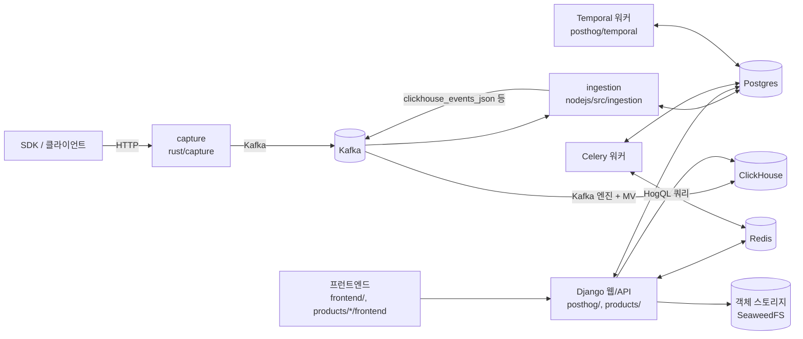

# 시스템 구성도

이 저장소는 PostHog 포크다.
아래 그림은 이벤트 수집·저장·조회에 관여하는 주요 구성 요소를 코드에서 확인한 범위로 정리한 것이다.
이벤트 하나가 지나가는 경로의 상세는 [데이터 흐름](data-flow.md)을 본다.

## 구성 요소

| 구성 요소 | 위치 | 역할 |
| --- | --- | --- |
| capture | `rust/capture/` | SDK 요청을 받아 Kafka로 보내는 Rust 수집 서비스. 토픽 기본값은 `rust/capture/src/config.rs`에 있다 |
| ingestion | `nodejs/src/ingestion/` | Kafka에서 이벤트를 읽어 person·group 처리 후 ClickHouse용 토픽으로 다시 쓰는 Node 컨슈머. 진입점은 `nodejs/src/ingestion/ingestion-consumer.ts` |
| Django 웹/API | `posthog/`, `products/` | REST API, 관리자, HogQL 쿼리 실행. 라우팅 골격은 `posthog/api/__init__.py`, 설정은 `posthog/settings/web.py` |
| ClickHouse | `posthog/clickhouse/`, `posthog/models/*/sql.py` | 이벤트·person·세션 저장소. 스키마와 마이그레이션이 여기 있다 |
| Postgres | `posthog/models/`, `products/*/backend/models/` | 조직·팀·인사이트·플래그 등 설정성 데이터 |
| Celery | `posthog/celery.py`, `posthog/tasks/` | 주기 작업과 비동기 작업. 브로커는 Redis |
| Temporal | `posthog/temporal/` | 장기 워크플로(내보내기, 삭제, 데이터 모델링 등) |
| Redis | 설정은 `posthog/settings/` | 캐시와 Celery 브로커 |
| 객체 스토리지 | SeaweedFS | 루트 `AGENTS.md`의 설명에 따라 일반 스토리지(`objectstorage`)와 세션 리플레이 v2(`seaweedfs`) 둘 다 SeaweedFS |
| 프런트엔드 | `frontend/`, `products/*/frontend/` | React 앱 |

## 그 밖의 서비스

- `rust/`: Cargo 워크스페이스. `capture`, `feature-flags`, `cymbal`(에러 트래킹), `personhog-*`(person 데이터 접근), `property-defs-rs`, `kafka-deduplicator`, `usage-ingestion` 등 다수의 크레이트가 있다. 각 크레이트의 역할은 [모듈 지도](modules.md)를 본다.
- `services/`: 제품 하나에 속하지 않는 독립 서비스. `llm-gateway`, `mcp`, `oauth-proxy`, `stripe-app`, `agent-proxy`, `credentials-service`, `hogql-language-service`, `stripe-mock`이 있다.
- `nodejs/src/`: `ingestion`, `cdp`, `session-replay`, `logs`, `messaging`, `ai-observability` 등 Node 서버 기능. `capabilities.ts`가 프로세스별로 어떤 기능을 켤지 정한다.
- `products/`: 제품별 Django 앱과 프런트엔드. 격리 규칙은 [products/README.md](../products/README.md), 설계는 [products/architecture.md](../products/architecture.md)를 본다.
- `devenv/intent-map.yaml`: 개발 환경에서 어떤 프로세스(Celery 워커, Temporal 워크플로 등)를 함께 띄울지 정의한다.

디렉터리 배치 규칙은 [docs/internal/monorepo-layout.md](../docs/internal/monorepo-layout.md)에 있다.

## 미확인

- 각 Node 서버의 프로세스 분리 방식(`capabilities.ts` 기준)의 세부 조합.
- 세션 리플레이 수집 경로(capture → `session_recording_snapshot_item_events` 이후)의 컨슈머 상세.
- 운영 배포 토폴로지(이 저장소에서는 확인하지 못했다).

Decided in: buzzhog-6y7m
